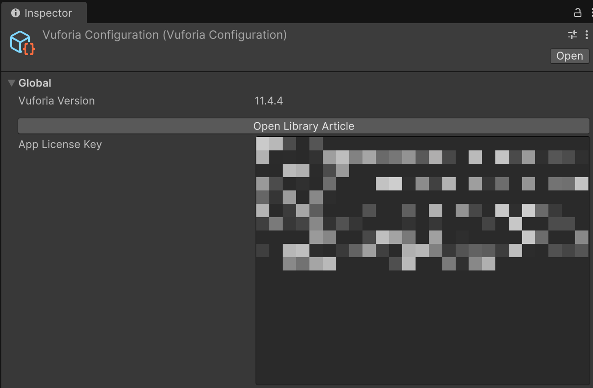
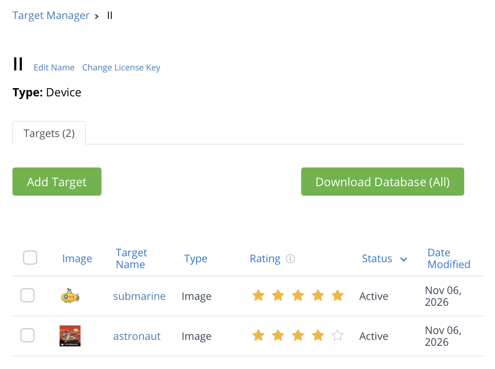
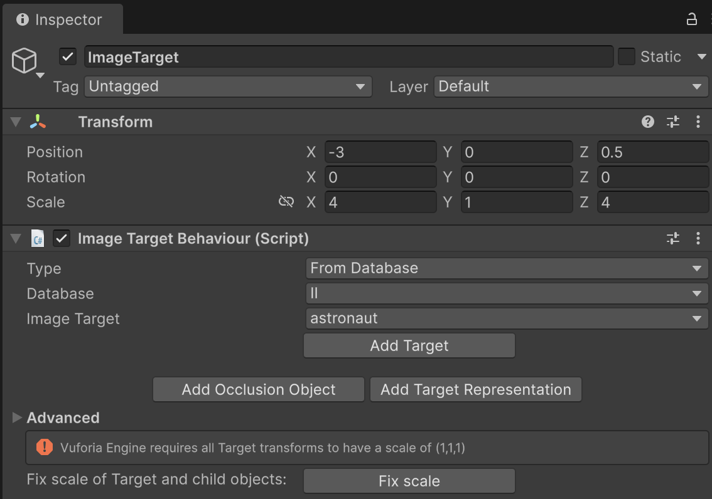
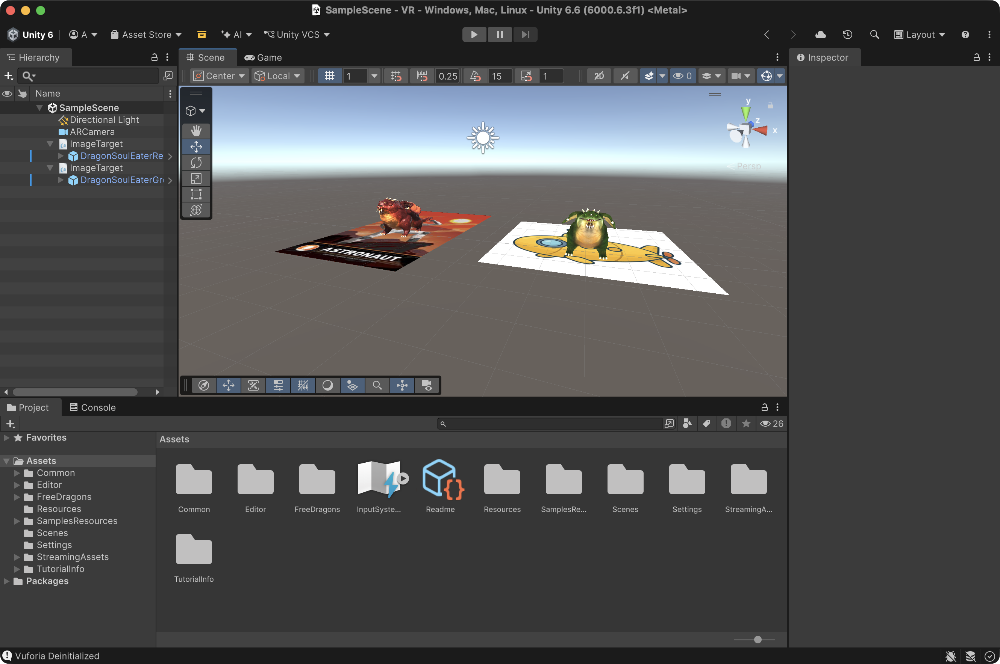

# Práctica 7 - Realidad Aumentada con Vuforia en Unity

Asignatura: Interfaces Inteligentes  
Universidad: Universidad de La Laguna  
Titulación: Grado en Ingeniería Informática  
Curso: 2026/2027  
Fecha: 13 de noviembre de 2026

## 📽️ Resultado final


## 📖 Descripción

Aplicación de **Realidad Aumentada** desarrollada con **Unity** y el motor **Vuforia Engine**. La aplicación utiliza la cámara del dispositivo para detectar dos imágenes objetivo (*Image Targets*) y, al reconocer cada una, renderiza sobre ella un modelo 3D distinto:

| Imagen objetivo | Modelo 3D asociado |
|---|---|
| `astronaut` | 🔴 Dragón rojo (`DragonSoulEaterRe...`) |
| Imagen del submarino amarillo | 🟢 Dragón verde (`DragonSoulEaterGr...`) |

Los modelos pertenecen al paquete gratuito **FreeDragons** (carpeta `Assets/FreeDragons`).

## 🛠️ Tecnologías y entorno

- **Unity** 6.6 (`6000.6.3f1`)
- **Vuforia Engine** (integrado como paquete de Unity)
- **Cámara:** webcam del ordenador

## 🗂️ Estructura del proyecto

```
Assets/
├── Editor/              # Configuración de Vuforia
├── FreeDragons/         # Modelos 3D de los dragones (prefabs)
├── Resources/           # Configuración y licencia de Vuforia
├── SamplesResources/    # Imágenes y base de datos de objetivos (II)
├── Scenes/
│   └── SampleScene      # Escena principal de RA
└── StreamingAssets/     # Base de datos de objetivos de Vuforia
```

## 🧩 Jerarquía de la escena

```
SampleScene
├── Directional Light
├── ARCamera
├── ImageTarget            → imagen: astronaut
│   └── DragonSoulEaterRe...   (dragón rojo)
└── ImageTarget            → imagen: submarino
    └── DragonSoulEaterGr...   (dragón verde)
```


## ⚙️ Pasos realizados

### 1. Creación del proyecto y configuración de Vuforia
Se crea un proyecto nuevo en Unity, se añade Vuforia Engine y se sustituye la `Main Camera` por el prefab **ARCamera** para evitar duplicidades (por ejemplo, de audio).

### 2. Licencia de Vuforia
Se genera una clave gratuita en el [License Manager](https://developer.vuforia.com/targetmanager/licenseManager/licenseListing) de Vuforia y se introduce en la configuración de Vuforia del objeto `ARCamera`.



### 3. Base de datos de objetivos
Se crean las imágenes objetivo en el **Target Manager** de Vuforia, se descarga la base de datos (paquete de Unity) y se importa al proyecto. En este proyecto la base de datos se llama `II`.



### 4. Image Targets
Se añaden dos prefabs **ImageTarget** a la escena. En el componente *Image Target Behaviour* de cada uno se configura:

- **Type:** `From Database`
- **Database:** `II`
- **Image Target:** `astronaut` en el primero y la imagen del submarino en el segundo

Además, se colocan en posiciones distintas para que no se solapen.



### 5. Objetos 3D asociados a los objetivos
Cada dragón se añade como **hijo** de su `ImageTarget` correspondiente, centrado sobre la imagen y con una escala adecuada. De este modo, el componente *Default Observer Event Handler* de Vuforia lo muestra únicamente cuando se detecta la imagen y lo oculta cuando se pierde, **sin necesidad de escribir ningún script**.



## ▶️ Cómo ejecutar el proyecto

1. Clonar el repositorio y abrirlo con **Unity 6.6 (6000.6.3f1)** desde Unity Hub.
2. Abrir la escena `Assets/Scenes/SampleScene`.
3. Seleccionar el `ARCamera` e introducir **tu propia License Key** de Vuforia en la configuración del motor (ver paso 2).
4. Conceder permiso de cámara a Unity en *Ajustes del Sistema → Privacidad y seguridad → Cámara*.
5. Pulsar **Play**.
6. Mostrar a la webcam las imágenes objetivo (desde la pantalla del móvil o impresas):
   - Imagen `astronaut` → aparece el dragón rojo 🔴
   - Imagen `submarine` → aparece el dragón verde 🟢
